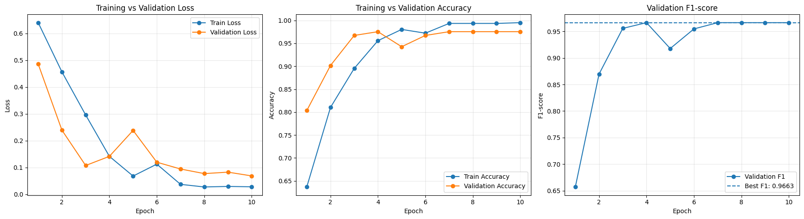
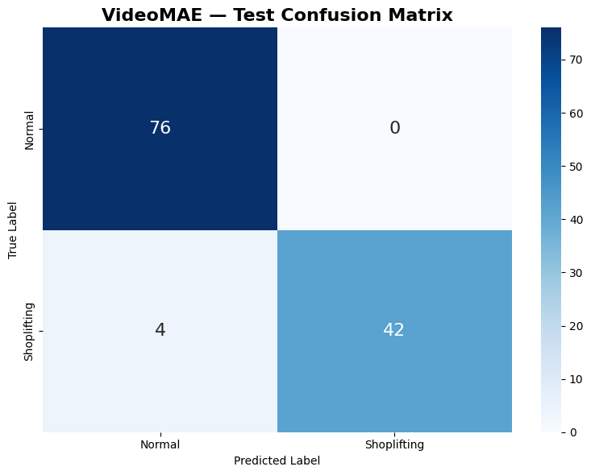

# Week 6 — Pretrained VideoMAE Fine-Tuning

[← Back to complete ShopGuard project](../README.md) · [Open completed notebook](shoplifting_videomae.ipynb) · [Results CSV](results/same_test_set_comparison.csv)

## Objective
Fine-tune a Hugging Face Kinetics-pretrained VideoMAE model for binary video classification (normal shopping vs shoplifting), and compare its performance against the Week 5 from-scratch 3D CNN.

## Dataset and protocol
- 855 labelled clips (531 normal / 324 shoplifting).
- Group-aware Week 6 split: 611 training, 122 validation, 122 test videos. No identical file IDs or computed `Group_ID` values overlap across Week 6 splits.
- VideoMAE: 16 uniformly sampled RGB frames per clip, aspect-ratio-preserving padding to 224 × 224, pretrained image processor; train-only consistent clip-level spatial/color augmentation.
- 3D CNN: re-evaluated with its saved Week 5 weights on **the same 122 Week 6 test clips**, using 16 frames and 160 × 160 RGB inputs normalized to [0,1].
- Important limitation: the original Week 5 training manifest was not saved. Possible overlap between the Week 5 **training clips** and the shared Week 6 test set cannot be ruled out. Same-test-set inference does not establish the independence of the baseline's original training data.

## Reported test results (122 clips)

| Metric | 3D CNN baseline | Fine-tuned VideoMAE |
|---|---:|---:|
| Accuracy | 87.70% | **96.72%** |
| Precision | 80.39% | **100.00%** |
| Recall | 89.13% | **91.30%** |
| F1-score | 84.54% | **95.45%** |
| Checkpoint size | 3.46 MB | 329.05 MB |
| GPU latency FP32, batch=1 | 3.539 ms | 121.453 ms |
| GPU latency AMP/FP16, batch=1 | 1.826 ms | 32.771 ms |

VideoMAE confusion matrix (rows: true normal/shoplifting; columns: predicted normal/shoplifting): `[[76, 0], [4, 42]]`. These are **single-split, single-run** results, not a statistical significance claim. The FP32/AMP timings are model-forward timings on one Tesla T4 GPU with synthetic inputs and do **not** include video decoding or preprocessing. Each model uses its required input resolution. The prior ~29.6 ms/video estimate used batch 4, AMP, and two GPUs, so it should not be directly compared with batch-1 FP32 latency.

## Running the notebook
1. Open `shoplifting_videomae.ipynb` in Kaggle with two Tesla T4 GPUs (or adjust hardware/batch size appropriately).
2. Attach the video dataset in the directory configured by `DATASET_PATH`, as well as the Week 5 baseline checkpoint (see checkpoint search in the notebook).
3. Enable internet to download `MCG-NJU/videomae-base-finetuned-kinetics` from Hugging Face on the first run.
4. Run cells in order. The notebook fine-tunes VideoMAE for 10 epochs, saves the best validation-F1 checkpoint to `/kaggle/working/best_videomae_shoplifting.pth`, evaluates models, and saves CSV tables and PNG plots in `/kaggle/working`.

Notebook execution was recorded with `transformers==5.16.1` and `torch==2.11.0+cu128`. The notebook includes a checkpoint attention-bias compatibility correction for these versions. Kaggle also supplies GPU-specific libraries; do not assume that `pip install` alone reproduces its environment. The augmentation RNG is not fully seeded, so fresh training runs may not generate identical results.

## Checkpoints and GitHub
The fine-tuned VideoMAE checkpoint is around 329 MB, exceeding GitHub's normal 100 MB file limit. Do **not** add it directly to a Git repository. If publishing weights, use an appropriate model hosting service or Git LFS, subject to the dataset/model licenses and permissions. The `.gitignore` excludes large model/video files. This repository includes code and saved notebook outputs; original video data and trained weights are separate.

## Limitations
- Week 5 original train/test membership cannot be proven from the checkpoint alone.
- 122 test videos (46 positive) are a small sample; multiple runs, data leakage audits and confidence intervals would strengthen conclusions.
- Four shoplifting videos were missed by VideoMAE; for security applications, missed positives matter and thresholds should be selected using validation data, never the test set.
- The model output is only a screening signal, **not proof of theft**.

## Figures

